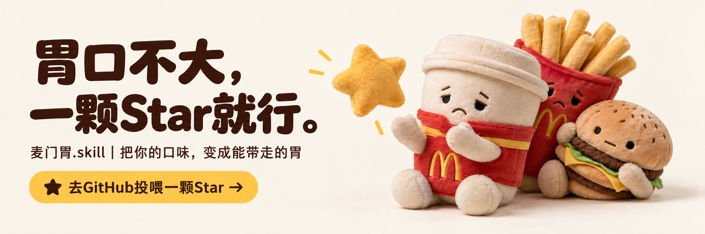
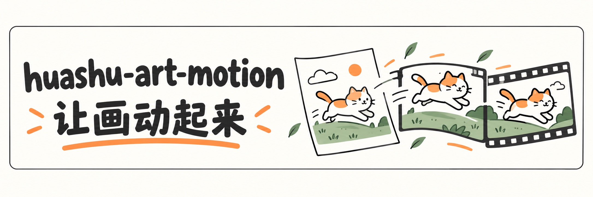
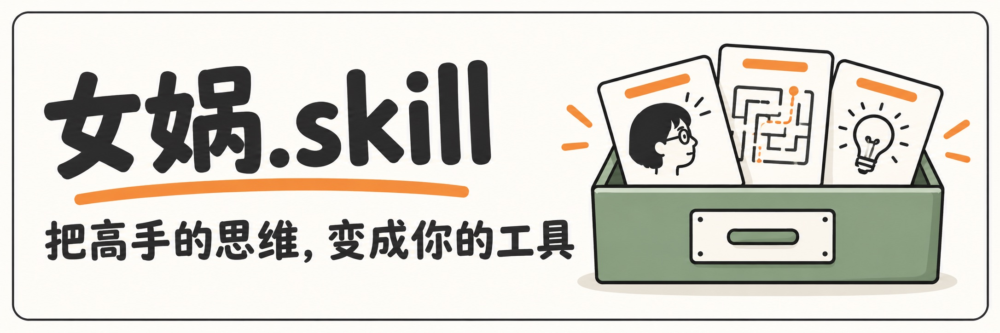
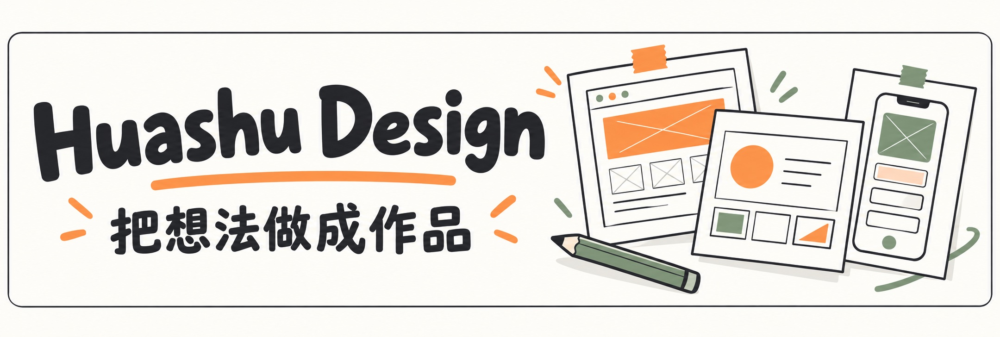
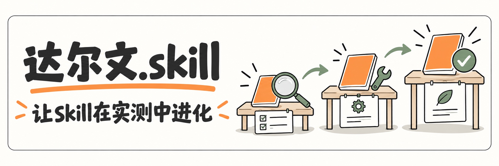
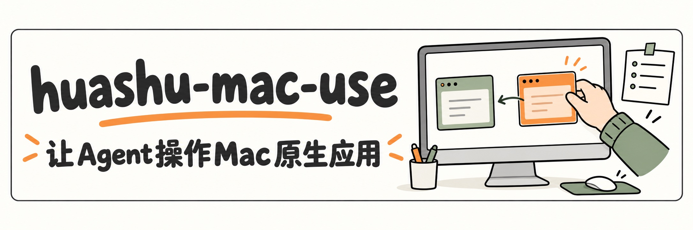

<!-- MCSTOMACH-PROMO-202610-START -->

我用女娲把自己的胃蒸馏成了Skill，还长出了毛绒分身。去看看你的胃是什么性格，觉得好玩，就在仓库右上角点颗Star。

[🍟 看看麦门胃，投喂一颗Star →](https://github.com/alchaincyf/mcstomach)
<!-- MCSTOMACH-PROMO-202610-END -->

我是花叔，一个不会写代码的创造者。从小猫补光灯到开源Skill，我用AI把想法做成产品，也把做过的项目写成教程和橙皮书。

<!-- STATS-START -->

<!-- STATS-END -->

## 最近在做：让画动起来

让Coding Agent把艺术风格写成动画。想先看效果，可以从「花叔闯进超级玛丽」和「Clawd博物馆奇妙夜」开始。

[看动画样片](https://github.com/alchaincyf/huashu-art-motion#动画样片) · [开始使用](https://github.com/alchaincyf/huashu-art-motion#里面有什么) · [下载完整成片](https://github.com/alchaincyf/huashu-art-motion/releases/latest)

## 从这里开始

提炼一个人的心智模型、决策方法和表达方式，变成可以反复调用的Skill。 [打开女娲 →](https://github.com/alchaincyf/nuwa-skill)

也可以直接试试：[乔布斯视角](https://github.com/alchaincyf/steve-jobs-skill) · [X运营](https://github.com/alchaincyf/x-mentor-skill)

用HTML做原型、幻灯片、动画和信息图，从定方向到检查成品。 [打开Design →](https://github.com/alchaincyf/huashu-design)

把文件、终端和每一次改动放在一起，看清Agent做了什么，随时接手。 [打开FanBox →](https://github.com/alchaincyf/fanbox)

## 给Agent配上工具

评估、改进、测试，保留有效改动，回滚退步。女娲造Skill，达尔文磨Skill。 [打开达尔文 →](https://github.com/alchaincyf/darwin-skill)

使用你自己的Chrome和已有登录态操作网页，把站点经验留下来。 [打开浏览器工具 →](https://github.com/alchaincyf/huashu-chrome)

让Agent操作没有API的Mac原生应用：先探测可用通道，再执行并留下取证。 [打开Mac工具 →](https://github.com/alchaincyf/huashu-mac-use)

## 边做边学

用到哪里，写到哪里。把真实项目里走通的步骤，整理成能跟着动手的指南。

[阅读橙皮书](https://bookai.top) · [Claude Code](https://github.com/alchaincyf/claude-code-orange-book) · [Hermes Agent](https://github.com/alchaincyf/hermes-agent-orange-book) · [Obsidian AI](https://github.com/alchaincyf/obsidian-ai-orange-book)

## 一起把想法做出来

**公众号「花叔」**：用微信扫码，或在微信搜一搜「花叔」。

[B站：花叔v](https://space.bilibili.com/14097567) · [小红书：花叔](https://www.xiaohongshu.com/user/profile/5abc6f17e8ac2b109179dfdf)

手机上不方便扫码，可以直接点上面的平台链接；[打开二维码大图](assets/follow.svg)。

[个人网站](https://www.huasheng.ai/) · [X](https://x.com/AlchainHust) · [YouTube](https://www.youtube.com/@Alchain) · [更多开源项目](https://github.com/alchaincyf?tab=repositories)

合作联系：alchaincyf3@gmail.com
